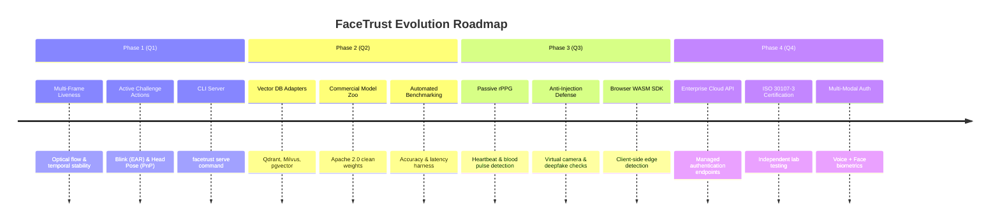

# 🗺️ FaceTrust Product & Engineering Roadmap

This document outlines the strategic engineering roadmap and commercialization blueprint for **FaceTrust**, designed to establish an open standard for modular, anti-spoofing face authentication.

---

## 🎯 1. Vision & Commercialization Strategy

FaceTrust adopts an **Open-Core** model:
- **Community Edition (100% Open-Source / MIT)**: Modular Python library, local ONNX inference, BlazeFace detection, MiniFASNet anti-spoofing, ArcFace embedding, in-memory 1:N matching, and FastAPI integration.
- **Enterprise & Cloud Edition**: ISO 30107-3 PAD compliance certification, multi-frame rPPG pulse verification, virtual camera injection defense, distributed vector cluster scaling (Milvus/Qdrant), and managed cloud APIs.

```
+-----------------------------------------------------------------------------------+
|                           FACETRUST ENTERPRISE / CLOUD                           |
|  - rPPG Cardiovascular Pulse Detection        - ISO 30107-3 PAD Compliance Audit  |
|  - Virtual Camera / OBS Injection Defense     - Distributed Vector DB Clustering  |
|  - Multi-Tenant Identity Management           - Browser WebAssembly Edge SDK      |
+-----------------------------------------------------------------------------------+
                                         │
                                         ▼ (Builds Upon)
+-----------------------------------------------------------------------------------+
|                         FACETRUST CORE (OPEN SOURCE / MIT)                        |
|  - Modular Client Facade (FaceTrust)          - Universal ModelRegistry & Plugins |
|  - BlazeFace Edge Detector (<15ms)            - MiniFASNetV2 Anti-Spoofing (2.7x) |
|  - Canonical 4-Point Affine 112x112 Aligner   - ArcFace 512-D MobileFaceNet Engine|
|  - Autonomous Cache & Downloader              - Native Async & Batch Processing   |
+-----------------------------------------------------------------------------------+
```

---

## 📅 2. Phased Release Roadmap



---

## 🔬 3. Technical Specifications by Phase

### 📍 Phase 1: Security Hardening & Active Challenges (Near-Term)

#### 1. Multi-Frame Temporal Liveness Analysis
* **Problem**: Single-frame 2D passive liveness can be tricked by high-resolution static cutouts or carefully lit paper.
* **Solution**: Ingest a video clip of 5–15 frames ($150 - 500\text{ ms}$). Compute optical flow vectors and texture phase consistency across frames:
  - Real human faces exhibit continuous micro-expressions, breathing tremor, and natural eye saccades.
  - Printed paper and static screens display rigid, flat planar homography.

#### 2. Active Challenge-Response Engine
* **Eye Aspect Ratio (EAR) for Blink Detection**:
  $$\text{EAR} = \frac{\|p_2 - p_6\| + \|p_3 - p_5\|}{2 \|p_1 - p_4\|}$$
  Prompts user: *"Please blink naturally"* $\rightarrow$ detects EAR dipping below threshold ($< 0.20$) and returning to baseline ($> 0.30$).
* **Perspective-n-Point (PnP) Head Pose Verification**:
  Prompts user: *"Turn head slightly to the left / right"* $\rightarrow$ computes 3D Euler angles (Yaw, Pitch, Roll) using 6 landmark anchors and standard 3D face model points.

#### 3. CLI Server (`facetrust serve`)
* Add immediate zero-configuration microservice capability:
  ```bash
  facetrust serve --host 0.0.0.0 --port 8000 --workers 4
  ```
  Spawns a production-tuned Uvicorn/FastAPI server with Swagger UI and pre-configured endpoints.

---

### 📍 Phase 2: Enterprise Scalability & Permissive Licensing (Mid-Term)

#### 1. Distributed Vector Database Adapters
* Abstract gallery matching beyond in-memory NumPy dictionaries:
  - **`QdrantStorage`**: HNSW index over Qdrant cloud/cluster ($100\text{M}+$ identities, $< 15\text{ ms}$ query).
  - **`MilvusStorage`**: High-concurrency enterprise vector database connector.
  - **`PgVectorStorage`**: Seamless integration with existing PostgreSQL enterprise databases.
  ```python
  from facetrust import FaceTrust
  from facetrust.backends.storage import QdrantStorage

  auth = FaceTrust(storage=QdrantStorage(url="https://xyz.qdrant.io", api_key="..."))
  ```

#### 2. Commercially Clean Model Zoo (Permissive Weights)
* **Problem**: InsightFace `buffalo_s` weights contain non-commercial academic clauses in certain upstream licenses.
* **Solution**: Introduce a drop-in **Commercially Clean Model Zoo**:
  - **AdaFace** trained on WebFace4M (permissive license).
  - **EdgeNeXt / MobileFaceNet** models trained on synthetic or legally cleared datasets with explicit **Apache 2.0 / MIT** commercial clearance.

#### 3. Automated Benchmark & Accuracy Evaluation Suite
* CLI command `facetrust benchmark --dataset lfw` to report FAR (False Acceptance Rate), FRR (False Rejection Rate), and ROC curves across standard datasets.

---

### 📍 Phase 3: Advanced Passive Biometrics & Edge AI (Advanced)

#### 1. Passive rPPG (Remote Photoplethysmography) Pulse Detection
* **Physical Principle**: With every cardiac contraction, the heart pumps blood to facial capillary beds, subtly altering the absorption of ambient green light ($500 - 600\text{ nm}$).
* **Mechanism**:
  - Extract skin ROI (cheeks and forehead) across 60–120 video frames ($2 - 4\text{ seconds}$).
  - Apply spatial averaging and Chrominance (CHROM) signal decomposition.
  - Compute Fast Fourier Transform (FFT) power spectral density in the human physiological range ($40 - 200\text{ BPM}$).
  - **Outcome**: Silicone masks, photograph prints, and digital screens completely lack cardiovascular blood pulse rhythms.

#### 2. Virtual Camera & Stream Injection Defense
* **Problem**: Sophisticated attackers bypass webcams by routing pre-recorded deepfake videos through OBS Virtual Camera or v4l2loopback virtual drivers.
* **Defense Layers**:
  - Inspect browser `MediaTrackSettings` and USB device hardware descriptors.
  - Monitor frame delivery jitter and hardware timestamp anomalies.
  - Evaluate spatial frequency artifacts characteristic of generative GAN / Diffusion face swaps.

#### 3. Edge WebAssembly (WASM) & Mobile SDKs
* Compile lightweight BlazeFace detection into WebAssembly for client-side evaluation:
  - Performs face centering and pre-filtering directly in the user's browser, eliminating server-side bandwidth and CPU overhead for empty frames.
  - Sends high-quality uncropped frames only when valid human presence is validated.

---

### 📍 Phase 4: Enterprise Cloud & Compliance (Commercial Launch)

#### 1. ISO/IEC 30107-3 Presentation Attack Detection (PAD) Certification
* Submit FaceTrust anti-spoofing engine to independent biometric testing laboratories (e.g. iBeta Quality Assurance) for formal Level 1 and Level 2 PAD compliance.
* Essential certification for enterprise banking, financial KYC, and government contracts.

#### 2. Multi-Modal Biometric Authentication
* Combine Face Verification with **Voice / Speaker Recognition** (ECAPA-TDNN feature vectors) for mission-critical authentication and step-up security.

---

## 💼 4. Business & Monetization Model

| Tier | Target Audience | Features & Pricing |
| :--- | :--- | :--- |
| **Open Source (MIT)** | Developers, Researchers, Startups | Local Python library, BlazeFace, MiniFASNet, ArcFace, In-Memory storage. **Free forever.** |
| **FaceTrust Pro** | Growing SaaS, EdTech, Fintech | Active Challenge Liveness, Qdrant/Milvus adapters, Commercially cleared model weights. **Developer license ($49 - $199/mo).** |
| **FaceTrust Enterprise** | Banks, Government, Large Orgs | ISO 30107-3 PAD certified, rPPG heart pulse verification, virtual camera injection protection, on-prem air-gapped deployment, SLA. **Annual contract ($5k - $50k/yr).** |

---

## 🤝 5. Contributing & Community Governance

We welcome contributions from the global biometric and computer vision community:
- Submit feature proposals via [GitHub Issues](https://github.com/NVKQ2022/FaceTrust/issues).
- Check the [Project Board](https://github.com/NVKQ2022/FaceTrust/projects) for active milestones.
- Read our [Architecture Blueprint](https://github.com/NVKQ2022/FaceTrust#readme) before submitting pull requests.
